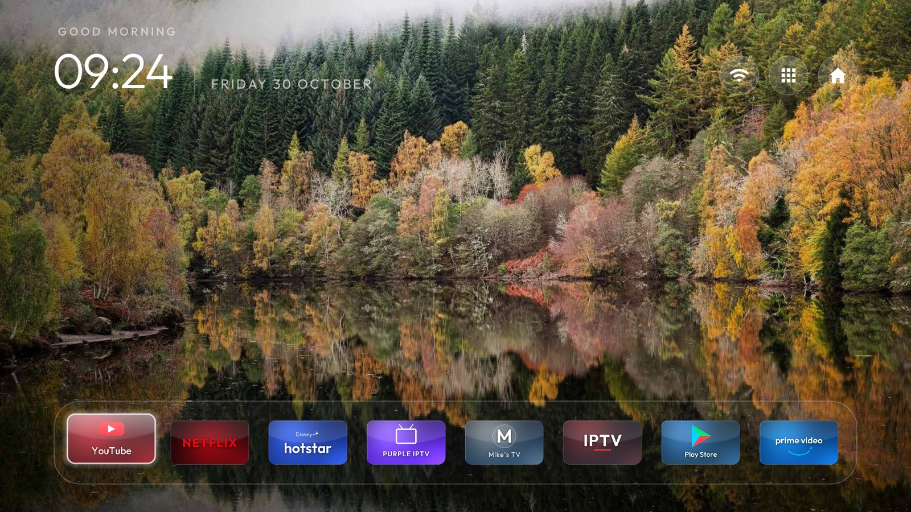
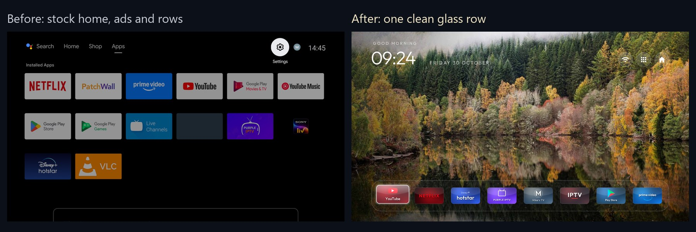
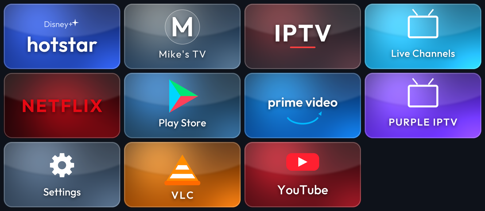
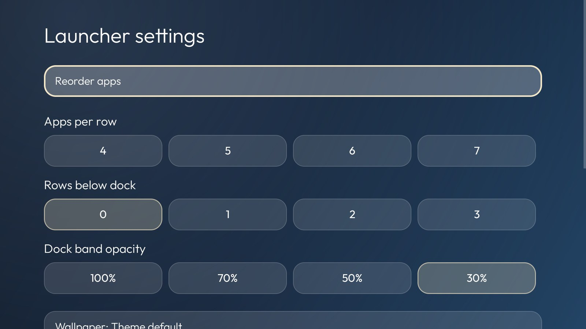
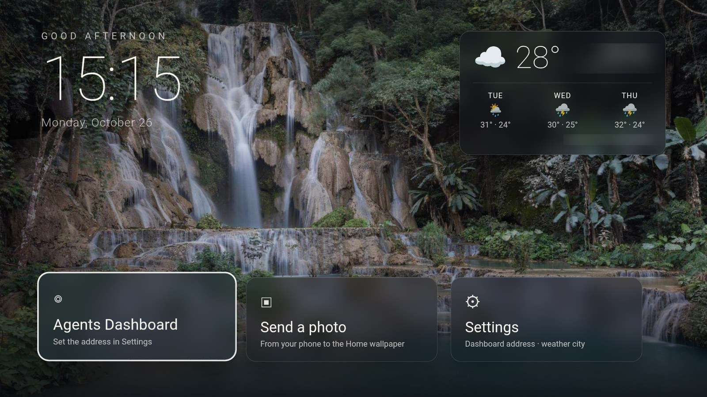
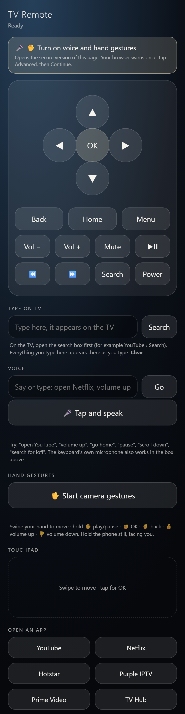
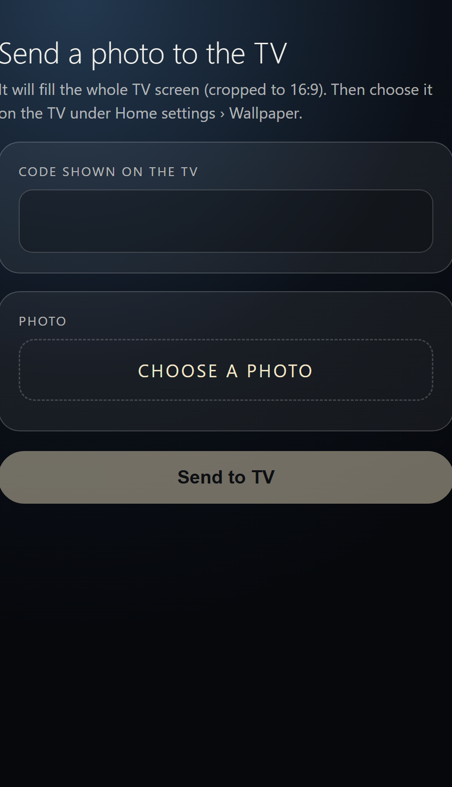
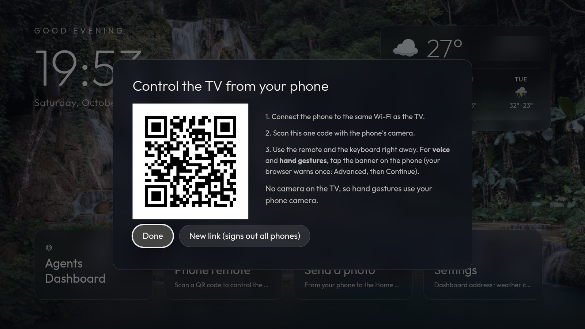
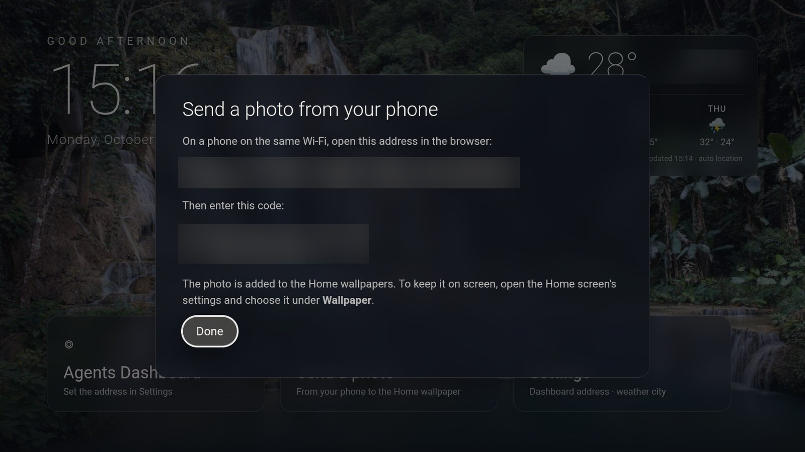

# glass-tv-home

**A clean, glass-style home screen for Android TV boxes. No sponsored rows, no clutter, one row of apps. Set up by an AI agent from a single prompt.**



Many Android TV and Google TV home screens are full of sponsored rows, trackers and apps you never asked for.
This project replaces that with a calm, premium-looking screen, and adds a few things a TV should have:
a phone remote you can **type on**, a family photo as wallpaper, live weather, and your own web dashboard.

Nothing is uninstalled, nothing is rooted, and one script puts everything back.



> **Status (v1.1):** built and verified on one device, a **Xiaomi Mi Box S** (Android 9). The one-shot prompt has
> not yet been run on any other model, so treat other devices as "should work, please report back".
> **New in 1.1: voice commands and hand gestures**, using the TV's own camera first if it has one (see below).

## What you get

| | |
|---|---|
| **Cleaner home** | Telemetry, ad tracking and sponsored content rows are *disabled* (never uninstalled). |
| **One glass row** | Every app in a single scrolling frosted-glass row, with nothing underneath. |
| **Custom glass tiles** | Each app gets a matching tile (brand colour glow, curved glass highlight, bold label). |
| **Boot logo** | A short "*Your Name*'s TV" animation after every restart. |
| **Glass settings** | The launcher settings page is restyled as frosted glass. A **Settings** tile opens Android's own Settings. |
| **TV Hub** | Clock, live weather with a 3-day forecast, your dashboard, photo upload, phone remote. |
| **Phone remote + typing** | Scan **one** QR code on the TV; any phone becomes a remote **with a keyboard** (type into YouTube search from your phone). |
| **Voice control** | Say "open Netflix", "volume up", "go home", "search for lofi" to the phone. Understood on the phone, sent to the TV. |
| **Hand gestures** | Swipe, open palm, fist, peace sign, thumbs up/down in front of a camera. Uses a camera on the TV if it has one, otherwise the phone's. |
| **Family photo wallpaper** | Send a photo from your phone; it becomes the full-screen background. |
| **One-line undo** | `tools/restore.ps1` re-enables everything and brings back the stock launcher. |

### The tiles



The tiles are drawn by [`design/make_tiles.py`](design/make_tiles.py) (Pillow + NumPy). Add an app by adding
one small function. The marks are simplified wordmarks and glyphs in brand colours, not copies of logos.

### Boot logo and settings

| Boot logo | Glass settings |
|---|---|
|  |  |

### TV Hub: weather, dashboard, photos



Weather comes from [Open-Meteo](https://open-meteo.com/) and is cached, so the clock and row work offline.
The **Agents Dashboard** card opens any web page you set (for example something served from a laptop or
Raspberry Pi) full screen, with arrow-key navigation injected so it works from a remote.

### Phone remote, typing and photos

| Remote with keyboard | Send a photo |
|---|---|
|  |  |

Open **TV Hub → Phone remote** and scan the **one** QR code. The remote, apps and typing work immediately. Hold the arrows to repeat, open apps, and use **Type on TV**: open a search box on the TV first (for YouTube, move to the **Search pill**, not the microphone) and what you type appears there live, backspace included.



**Voice and gestures:** tap the **"Turn on voice and hand gestures"** banner on the phone. It moves to the secure version of the same page (your browser warns once: *Advanced → Continue*), where you can tap **Tap and speak**, or **Start camera gestures** and hold a hand up. Without a camera on the TV the phone's camera is used; if the TV has a working camera, the Phone remote panel offers **Use the TV's camera** and the TV does the tracking itself.

| Say | It does |
|---|---|
| "open Netflix" / "go to YouTube" | opens the app |
| "volume up" / "turn it down by 5" / "mute" | volume |
| "go home" / "go back" / "pause" / "scroll down" | navigation and playback |
| "search for lofi hip hop" / "type hello" | types into the focused search box (search also presses Enter) |

| Gesture | It does |
|---|---|
| swipe left / right / up / down | arrow keys |
| open palm, held | play / pause |
| fist, held | OK |
| peace sign, held | back |
| thumbs up / down, held | volume up / down (repeats) |

There is also a **touchpad** on the phone page (swipe to move, tap for OK), which needs no permissions at all.



**Send a photo** shows an address and a 6-digit code. Open the address on a phone, enter the code, pick a photo
(it is cropped to 16:9 on the phone), and choose it under *Launcher settings → Wallpaper*.

## Set up a new TV with one prompt

1. On the TV: *Settings → Device Preferences → About*, press OK on **Build** seven times, then *Developer options → USB debugging* on.
2. Open [Claude Code](https://claude.com/claude-code) (or another coding agent with shell access) in an empty folder on a computer on the same Wi-Fi.
3. Paste the whole of **[`PROMPT-NEW-TV.md`](PROMPT-NEW-TV.md)** and put your name in `OWNER_NAME`.
4. When the TV asks "Allow USB debugging?", choose **Always allow**. The agent does the rest and checks each step with screenshots from the TV.

The prompt tells the agent to find the TV on your network, back everything up, disable the junk in small
batches, build and install the launcher, tiles, TV Hub and Settings app, and test it all. It adapts the visual
effects to the box's memory (full effects on 2 GB, lighter on 1 GB or less).

## How it works

```
 phone ──(one QR link, same Wi-Fi)──► TV Hub service :8090 (http) / :8091 (https) ──► TV's own adbd 127.0.0.1:5555 ──► key presses / app launches
 phone camera + mic (https page) ──► hand tracking and speech run on the phone ──► only key names reach the TV
 TV camera (if any) ──► same hand tracking inside TV Hub (127.0.0.1) ──► key presses
                                        │
 TV Hub app (WebView) ─ clock, weather, dashboard, photo upload
 Launcher (cleanyourtv, restyled) ─ one glass row, glass settings
 Settings tile app ─ opens the stock Android Settings
```

| Folder | What it is |
|---|---|
| `hub-app/` | **TV Hub**: Java app with a WebView UI, a small LAN server (http and https), an on-box ADB client, a boot splash. Hand tracking is Google MediaPipe (fetched by `tools/fetch_mediapipe.py`). |
| `settings-app/` | A tiny app whose only job is a **Settings** tile. |
| `launcher-patch/` | The glass restyle of the launcher's settings (a patch for [cleanyourtv](https://github.com/Gathin23/cleanyourtv)). |
| `theme/` | Launcher theme (`config.json`) and 12 landscape wallpapers with credits. |
| `design/` | `make_tiles.py` and the generated tile/icon PNGs in `design/out/`. |
| `debloat/` | The example package list used on the Mi Box S. |
| `tools/` | `restore.ps1` (undo), `add-photo.ps1` (put a photo on the TV from a computer), `fetch_mediapipe.py` (downloads the 22 MB hand-tracking files before building). |
| `tests/js/` | Unit tests for the voice-command parser and the gesture classifier: `node --test tests/js/web.test.js`. |
| `PROMPT-NEW-TV.md` | The one-shot setup prompt. |

The launcher is **[cleanyourtv](https://github.com/Gathin23/cleanyourtv)** (MIT), built unchanged apart from the
patch and the tile images. Its repo also has debloat lists for many other TVs.

## Safety, privacy and honest risks

- **Reversible.** Packages are *disabled* with `pm disable-user`, never uninstalled. The prompt refuses to touch
  core Android packages, the TV/HDMI/input services, Play Store/Play Services, the assistant, Chromecast, the
  remote service or any update service. No root, flashing or factory menus.
- **USB debugging has to stay on** for the phone remote (Android 9 will not let an app press keys in other apps,
  so TV Hub sends them through the box's own debugging port). On many boxes this also opens **network ADB on
  port 5555, which is plain text and, once a computer is authorised, open to anyone on your LAN**. Do not expose
  5555 or 8090 to the internet, and think twice on a shared or untrusted Wi-Fi.
- **The phone remote is protected by a secret in the QR link** (kept after the `#`, so it is never sent in a
  request line or logged). Anyone who has the link can control the TV; **New link** in the panel revokes it.
  It is plain HTTP on the local network.
- **Camera and microphone** are used only on the phone page you open yourself, and only after you tap the button (and the browser's own permission prompt). Hand tracking runs on the phone (or on the TV for a TV camera) with files bundled in TV Hub, so no video leaves the device. **Speech recognition is the phone browser's own service**: on Chrome and Safari the audio goes to Google or Apple to be turned into text, which then goes to the TV. If that matters to you, use the typed command box instead; it is parsed on the phone with no cloud.
- **Secure address (:8091):** phone browsers only allow the camera and microphone on https pages, so TV Hub serves a second, https address with a certificate the box generates for itself (the private key stays in Android's key store, and no two boxes share one). Browsers warn once about it; that is expected for a self-signed certificate on a home network.
- **Photo upload** needs a one-time 6-digit code shown on the TV and accepts only JPEG up to 8 MB.
- **Network calls the TV makes:** weather from `api.open-meteo.com`; with automatic location, the city is looked up
  from your network address via `ipapi.co` (fallback `ipwho.is`). Choose a city under *TV Hub → Settings* to avoid
  the lookup. No analytics, no accounts, nothing is sent to the author.
- Black screenshots of Netflix/YouTube playback and of Android permission dialogs are normal; this project does not
  try to bypass them.

## Limitations

- Only verified on a Mi Box S (Android 9). The launcher needs Android 8 (API 26) or newer. Fire TV, Samsung (Tizen),
  LG (webOS) and Roku are different systems and are **not** supported.
- Ads *inside* apps (for example YouTube video ads) are not affected.
- Typing is limited to English letters, numbers and common symbols (Android's `input text`). Voice commands are English.
- **Gestures and voice are the least-tested part.** The command parser has unit tests. The hand classifier has unit tests *and* was checked with the real model on real open-palm, fist and thumbs-up photos (it ignores a relaxed, resting hand), and the whole phone page was driven over https against a real TV. It has **not** been used with a live phone camera, a real microphone or a TV-attached camera. Swipe thresholds in `classify.js` may need tuning for your room and phone.
- A USB webcam may not work on the TV: it needs Android's external-camera support. TV Hub shows what it found.
- The Xiaomi update service is left enabled on purpose; on other units it re-enabled PatchWall a few minutes after it was disabled.
- Standby turns the box's Wi-Fi off, so ADB is unreachable until you wake it with the remote.
- The weather card and dashboard card are fixed for now. Making the top-right widget removable is on the wish list.

## Customise

- **Name:** edit `hub-app/.../assets/splash.html`, and run `OWNER_NAME=Alex python design/make_tiles.py`.
- **Dock order and look:** `theme/config.json` (see the cleanyourtv theme docs for every key).
- **Wallpapers:** put JPEGs in `theme/wallpapers/`, or send a photo from your phone.
- **Tiles:** add a function in `design/make_tiles.py`, re-run it, copy `design/out/banner_*.png` into the launcher's `res/drawable-nodpi/` and add `package=banner_name` to its `app_banners`.

## Undo

```powershell
tools\restore.ps1 -TvHost <tv ip>:5555
adb shell pm uninstall com.mytvhome.hub
adb shell pm uninstall com.mytvhome.settings
adb shell pm uninstall com.gathin.tvhome
```

## Contributing

Issues and pull requests are welcome, especially: a verified list for another TV (add it as `debloat/<model>.txt`
with its quirks), more tiles, and results from running the prompt on other boxes. Never include IP addresses,
serial numbers, Wi-Fi names or account names in anything you post.

## Credits and licences

Code in this repository is **MIT** (see [LICENSE](LICENSE)). Third-party parts, the wallpaper photos
(Creative Commons, with credits) and trademark notes are listed in **[NOTICE.md](NOTICE.md)**.

This project is not affiliated with or endorsed by Google, Xiaomi, Netflix, YouTube, Disney, Amazon or any other
company named here. Their names appear only to identify the apps and belong to their owners.
